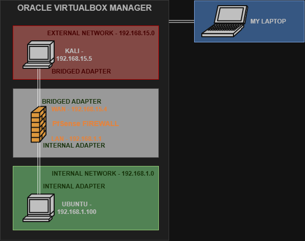
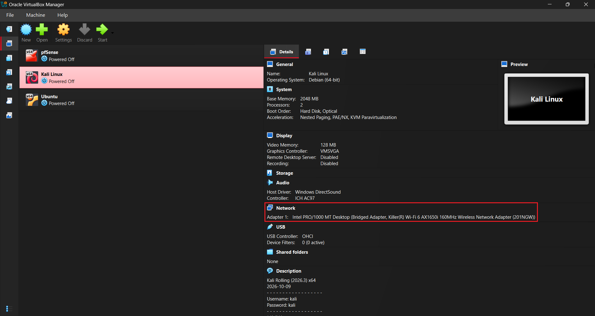
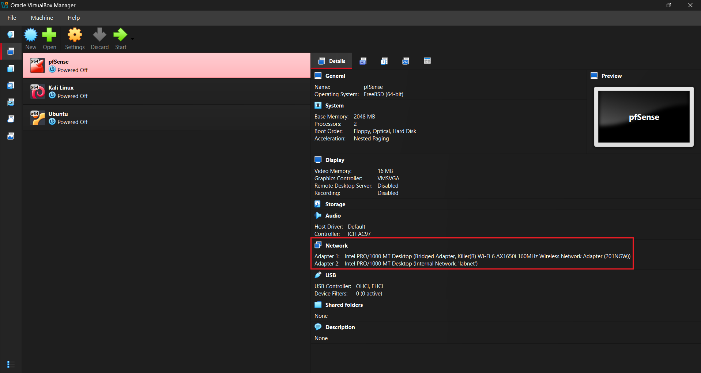
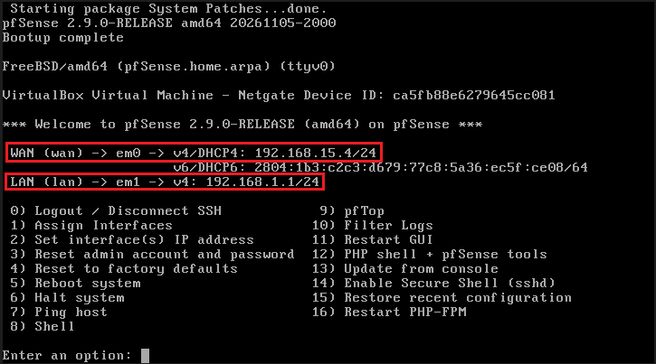
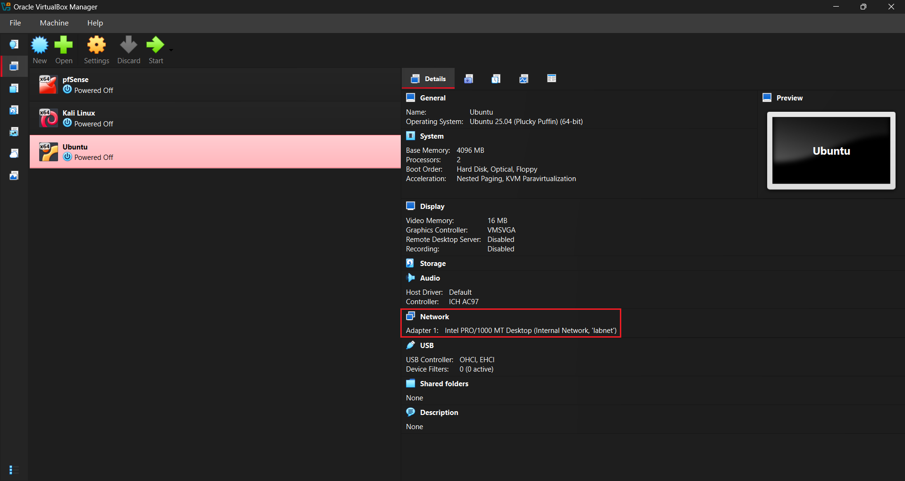

# pfSense Network Firewall Home Lab

A virtualized network security lab built with pfSense, Kali Linux, and Ubuntu Server to explore firewall configuration, network traffic filtering, and essential network services.

## Technologies Used

- **pfSense** - Firewall used.
- **Kali Linux** - External device.
- **Ubuntu** - Internal device.
- **Oracle VirtualBox** - Virtualization environment.
- **Ubuntu & Kali CLI** - Interface used for executing commands.
- **Wireshark** - Used to verify if hping packets are reaching Ubuntu.
- **DHCP and DNS Resolver** -  Services implemented.
- **TCP/IP** - Protocol used.

## Lab Architecture

The lab consists of three virtual machines running in VirtualBox. pfSense acts as the central firewall and router, separating the external network (WAN) from the internal network (LAN).

### IP Addressing

| Device | Interface / Network | Adapter | IP Address |
|---|---|---|---|
| Kali Linux | External Network | Brigded Adapter | 192.168.15.5 |
| pfSense | WAN | Bridged Adapter | 192.168.15.4 |
| pfSense | LAN | Internal Adapter | 192.168.1.1 |
| Ubuntu | Internal Network (`labnet`) | Internal Adapter | 192.168.1.100 |

### Network Topology

  

## Virtual Machine Environment

### Kali Linux

Used as the external machine to generate controlled nping traffic targeting the Ubuntu Server.

  

### pfSense Firewall

Used as the network firewall to manage traffic between WAN and LAN interfaces and configure DHCP, DNS Resolver, port forwarding, and firewall rules through its web interface.

  
  

### Ubuntu

Used as the internal machine to obtain an IP address via DHCP, validate DNS filtering, and capture nping packets generated by Kali Linux.

  

## Implemented Scenarios

### 1. DHCP Server Configuration

- Configured DHCP through the pfSense web interface.
- Enabled automatic IP address assignment for devices connected to the internal labnet network.

[View Scenario 1](dhcp-scenario.md)

### 2. DNS Resolver Configuration

- Configured the DNS Resolver through the pfSense web interface.
- Implemented DNS-based blocking of youtube.com for the Ubuntu machine.

[View Scenario 2](dns-scenario.md)

### 3. Firewall Traffic Filtering and Rule Configuration

- Configured port forwarding through the pfSense web interface.
- Created firewall rules to allow and block nping traffic originating from Kali Linux and targeting Ubuntu Server.

[View Scenario 2](firewall-rule-scenario.md)

## Key Skills Demonstrated

- Network Security and Architecture
- Firewall Configuration and Rule Management
- Packet Filtering and Traffic Analysis
- DHCP and DNS Configuration
- Virtualized Network Infrastructure
- Network Troubleshooting
