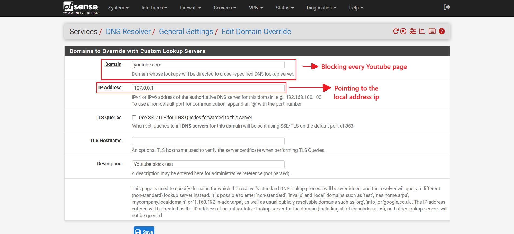
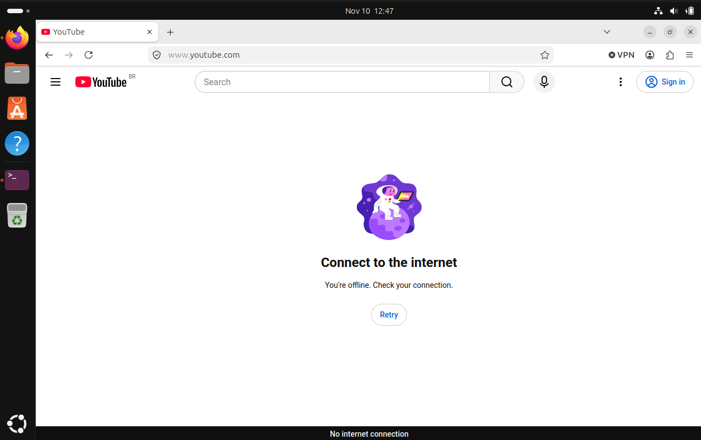

# 2. DNS Resolver Configuration

## Objective

Use the pfSense DNS Resolver to restrict access to `youtube.com` from the Ubuntu machine through domain-based DNS configuration. In this case, the configuration will block every page related to Youtube, including videos, channels, etc.

## Configuration

Accessed **Services → DNS Resolver → General Settings → Domain Overrides** and added a domain override entry for `youtube.com`.

The IP address was set to `127.0.0.1`, directing the configured domain to the local address.

  

## Validation

Before applying the configuration, YouTube was accessible from the Ubuntu machine.

  

After applying it, YouTube stopped responding and displayed the message "Connect to the Internet"

  

## Result

During validation, Ubuntu could no longer access YouTube after the Domain Override was configured with `127.0.0.1` as the DNS forwarding destination. The browser displayed the message "Connect to the Internet."

This demonstrates DNS resolution restriction in the tested configuration. Domain Override works by forwarding DNS queries for a specific domain to a designated DNS server, rather than directly replacing its IP address or creating a firewall rule. 

This configuration can be bypassed if users use alternative DNS servers.