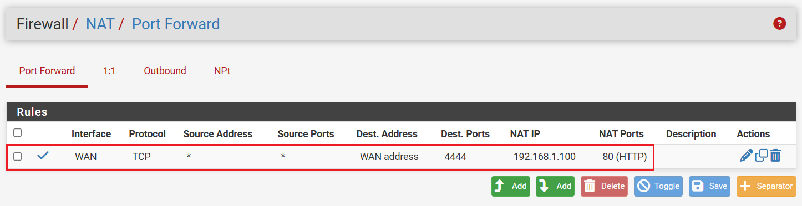
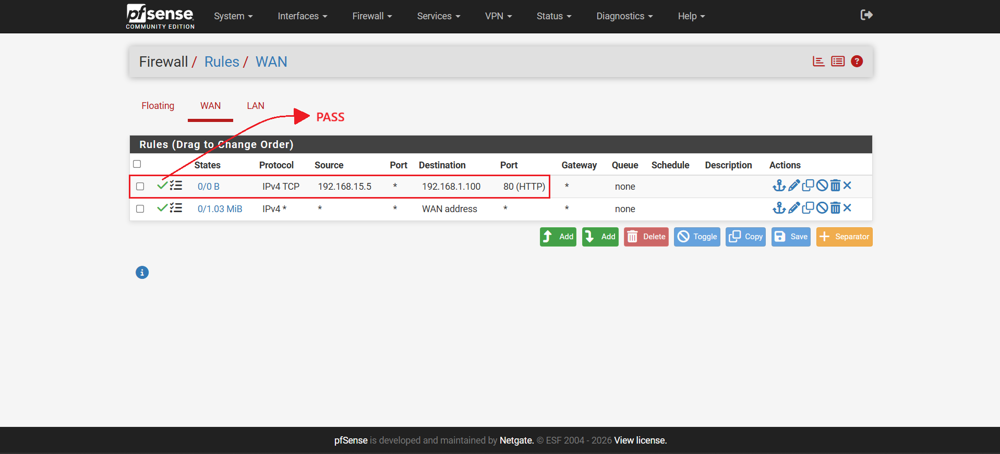
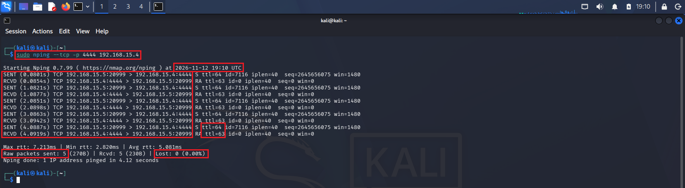
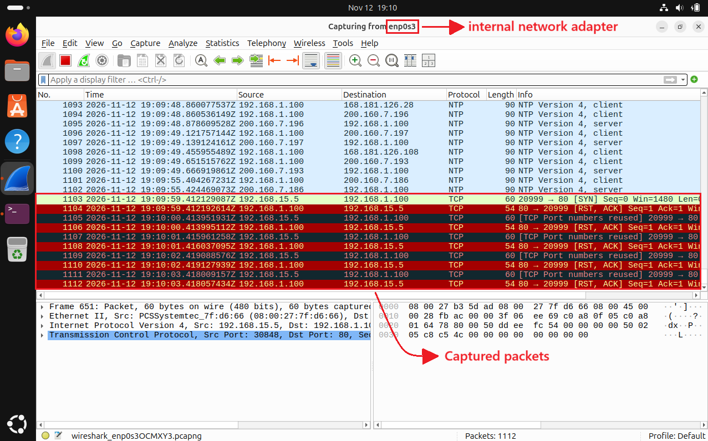
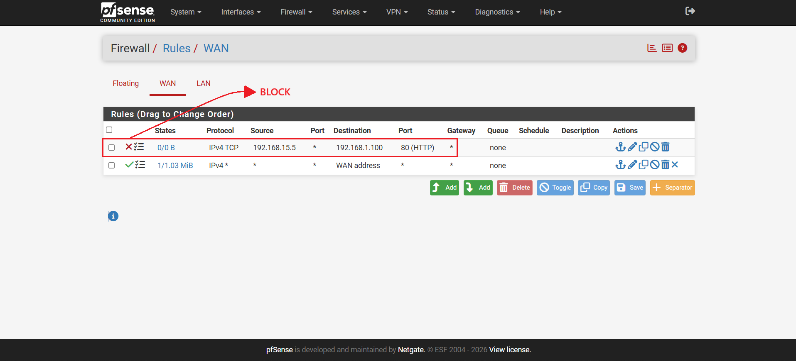
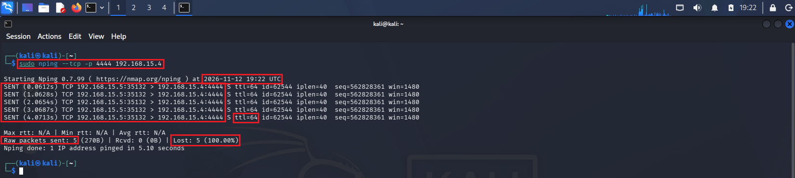
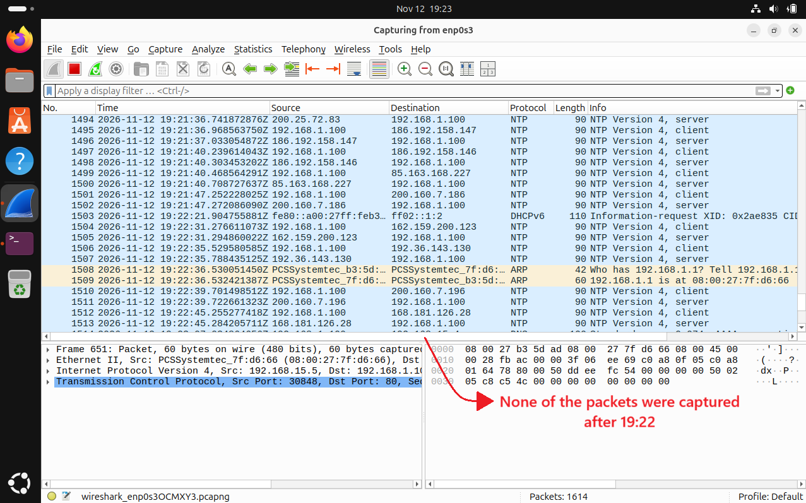
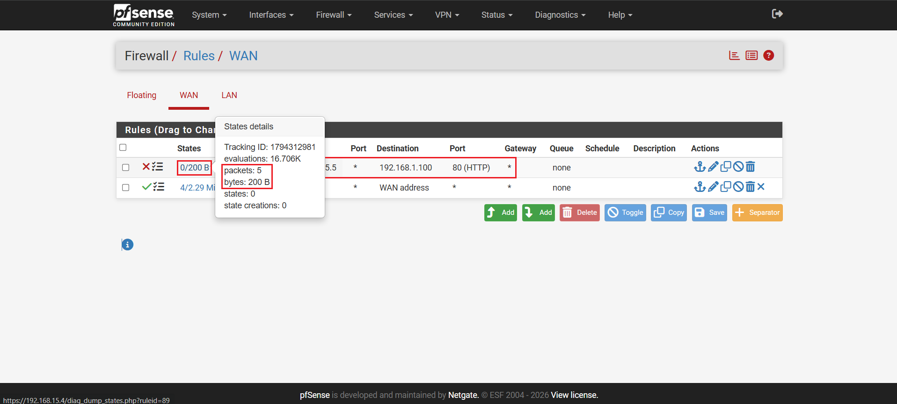

# Firewall Traffic Filtering and Rule Configuration

This scenario demonstrates how pfSense controls network traffic between Kali Linux and Ubuntu using port forwarding and firewall rules.

First, a port forwarding rule is configured to redirect incoming TCP traffic from the WAN interface to Ubuntu. A PASS rule is then tested using Nping, while Wireshark is used to inspect the returning packets.

Finally, the rule is changed to BLOCK, and the same test is repeated to verify how pfSense filters the traffic.

## 1. Port Forwarding Setup

A port forwarding rule was created through the pfSense interface under **Firewall / NAT / Port Forward** with the following parameters:

| Parameter | Configuration |
|---|---|
| Interface | WAN |
| Protocol | TCP |
| Source Address | Any |
| Source Ports | Any |
| Destination Address | WAN Address |
| Destination Port | 4444 |
| NAT IP | 192.168.1.100 |
| NAT Port | 80 (HTTP) |

This configuration redirects any incoming TCP traffic received at the WAN address on port `4444` to port `80` of the Ubuntu machine (`192.168.1.100`).

<p align="left">
  
</p>

## 2. WAN Firewall Rule (PASS)

A Pass rule was created under **Firewall / Rules / WAN** to allow IPv4 TCP traffic originating from Kali Linux and targeting the Ubuntu machine.

The rule was configured with the following parameters:

| Parameter | Configuration |
|---|---|
| Action | Pass |
| Protocol | TCP |
| Source Address | 192.168.15.5 |
| Source Port | Any |
| Destination Address | 192.168.1.100 |
| Destination Port | 80 |

This rule allows IPv4 TCP traffic from Kali Linux (`192.168.15.5`) to reach Ubuntu (`192.168.1.100`) through the WAN interface.

<p align="left">
  
</p>

## 3. TCP Traffic Test (PASS)

The following command was executed on Kali Linux to generate TCP traffic targeting the pfSense WAN interface on port `4444`:

```bash
sudo nping --tcp -p 4444 192.168.15.4
```

- `sudo`: Executes the command with administrative privileges.
- `nping`: Network packet generation and response analysis tool included in Nmap.
- `--tcp`: Specifies TCP as the packet protocol.
- `-p 4444`: Sets the destination port to 4444.
- `192.168.15.4`: Specifies the pfSense WAN IP address.

<p align="left">
  
</p>

All five TCP packets were successfully sent (`SENT`) and received corresponding responses (`RCVD`), with a Time to Live (TTL) of 63 and 64 and 0% packet loss. The test was performed at 19:10 UTC, confirming that all packets were successfully transmitted and responses were received through the pfSense firewall.

## 4. Wireshark Traffic Analysis (PASS)

Wireshark was configured on Ubuntu to capture all network traffic through the Internal Network adapter. No display filter was applied, allowing all captured packets to appear in the packet list.

During the test performed at 19:10 UTC, Wireshark displayed 10 packets associated with the communication between Kali Linux and Ubuntu, corresponding to the five TCP probes sent and their five responses.

<p align="left">
  
</p>

The first packet appeared in green, representing the first packet from Kali Linux to Ubuntu. The remaining packets alternated between red and black: red packets represented responses from Ubuntu to Kali Linux, while black packets represented traffic sent from Kali Linux to Ubuntu.

The capture also allowed inspection of the packet timestamps, source and destination IP addresses, TCP protocol, and port numbers. These details matched the Nping test performed at 19:10 UTC, confirming that the PASS rule allowed the traffic to reach Ubuntu and return responses to Kali Linux.

## 5. WAN Firewall Rule (BLOCK)

The previously configured WAN firewall rule was modified by changing its action from Pass to Block, keeping the same parameters to prevent traffic originating from Kali Linux (`192.168.15.5`) from reaching Ubuntu (`192.168.1.100`).

<p align="left">
  
</p>

## 6. TCP Traffic Test (BLOCK)

The same Nping command was executed again on Kali Linux to generate TCP traffic targeting the pfSense WAN interface on port `4444`:

<p align="left">
  
</p>

This time, the terminal showed that the packets were sent (`SENT`), but no responses were received (`RCVD`). This test was performed at 19:22 UTC. The test resulted in 100% packet loss, indicating that the firewall was blocking the traffic.


## 7. Wireshark Traffic Analysis (BLOCK)

Wireshark was kept running on Ubuntu, capturing all network traffic through the Internal Network adapter without applying any display filter.

During the test performed at 19:22, no packets corresponding to the Nping traffic from Kali Linux were observed reaching Ubuntu.

<p align="left">
  
</p>

Since no display filter was applied, all captured network traffic was displayed. The analysis focused on identifying packets associated with the test based on their timestamps, source and destination IP addresses, protocol, and ports.

The absence of the corresponding packets is consistent with the blocking behavior observed in the Nping test, where no responses were received.

## 8. Firewall Log Verification (BLOCK)

Logging was enabled for the WAN Block rule in pfSense, allowing the matching traffic to be recorded.

The firewall logs showed the packets being matched and blocked by the configured rule, confirming that pfSense was actively filtering the incoming traffic.

<p align="left">
  
</p>

## Test Results

The tests demonstrated how pfSense firewall rules control traffic between the external and internal networks.

During the PASS test, all five TCP probes received responses, resulting in 0% packet loss. Wireshark captured 10 packets corresponding to the communication between Kali Linux and Ubuntu, confirming successful traffic exchange.

During the BLOCK test, Kali Linux received no responses, resulting in 100% packet loss. Wireshark showed no corresponding Nping traffic reaching Ubuntu, while pfSense firewall logs confirmed that the packets were matched by the blocking rule.

This scenario demonstrated the practical application of port forwarding, firewall rule management, network traffic analysis, and firewall log monitoring.
