# 4. Suricata IDS and IPS Implementation

## Objective

Suricata was deployed on pfSense to monitor traffic from Kali Linux to Ubuntu using ET Open signatures. A TCP SYN scan generated with Nmap, from Kali Linux to Ubuntu, was performed to evaluate IDS capabilities, detect scanning activity, and generate security alerts. The IPS functionality was then tested using Legacy Mode, automatically blocking the source IP after detection and preventing further communication.

## Installation and Rule Configuration

Suricata was installed through the pfSense Package Manager under **System → Package Manager → Installed Packages**.

<p align="left">
  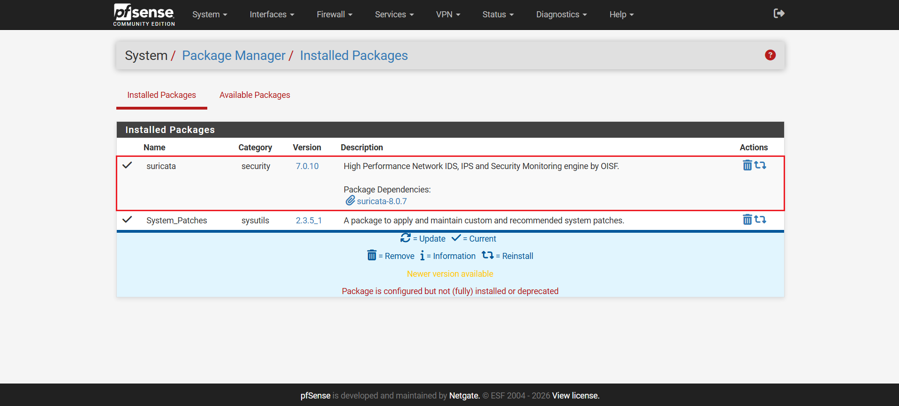
</p>

The Emerging Threats Open (ET Open) ruleset was selected through **Services → Suricata → Global Settings** as the source of detection signatures. Other rule providers were left disabled.

<p align="left">
  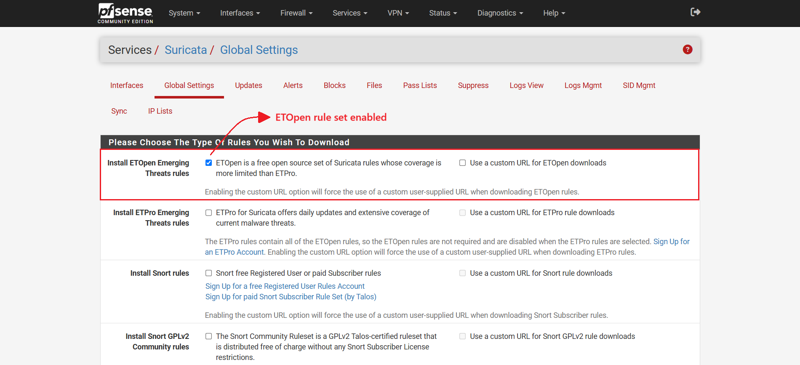
</p>

The ET Open rules were successfully downloaded and updated through the **Services → Suricata → Updates** page.

<p align="left">
  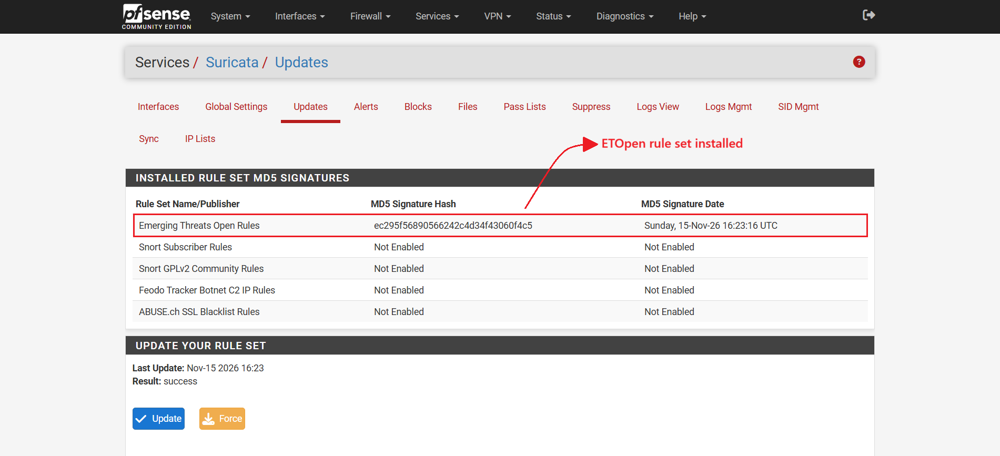
</p>

## WAN Interface Configuration

Suricata was enabled on the WAN interface to inspect incoming network traffic from Kali Linux to Ubuntu. Alert logging was enabled to record detected events in the pfSense system logs.

<p align="left">
  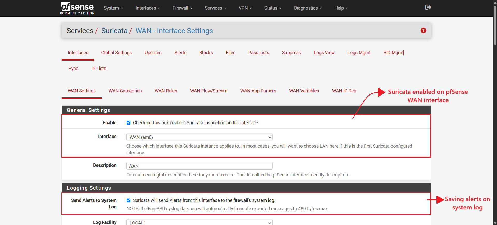
</p>

Additional logging and detection settings were configured, with Block Offenders initially disabled to allow traffic inspection without automatically blocking the source during the IDS test.

<p align="left">
  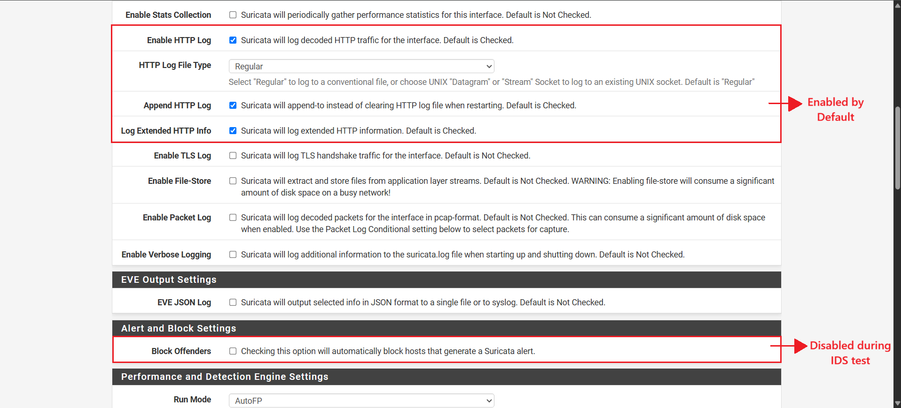
</p>

The interface was configured with the default HOME_NET and EXTERNAL_NET variables, allowing Suricata to distinguish internal and external network traffic. Promiscuous Mode was also enabled. The default network variables and other interface settings were retained.

<p align="left">
  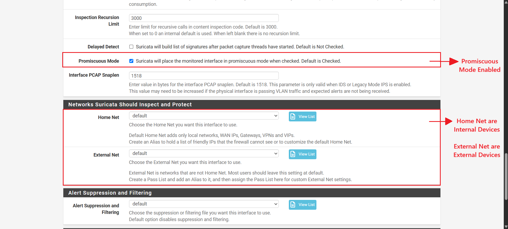
</p>

## Detection Rules Configuration

The `emerging-scan.rules` category from the Emerging Threats Open (ET Open) ruleset was enabled for the WAN interface to identify network scanning and reconnaissance activity.

<p align="left">
  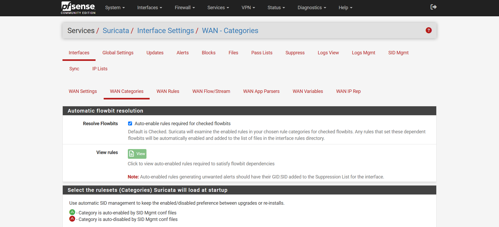
</p>

<p align="left">
  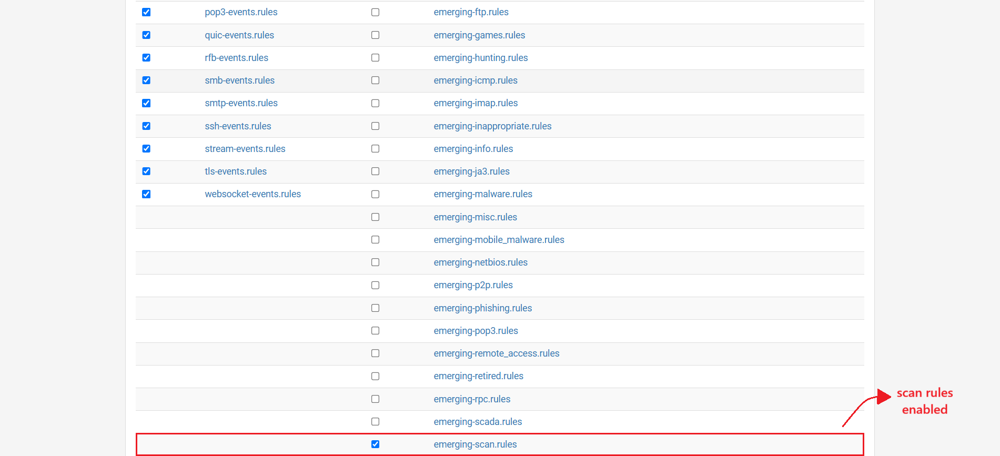
</p>

All rule signatures within the selected `emerging-scan.rules` category were enabled. During the Nmap SYN scan, the alert was generated by the specific signature **ET SCAN NMAP -sS window 1024** (SID: `2009582`).

This signature detects TCP SYN packets matching specific characteristics associated with Nmap SYN scans, including a TCP window size of 1024 bytes. In this lab, it matched the traffic generated by Nmap and triggered a corresponding security alert in Suricata.

<p align="left">
  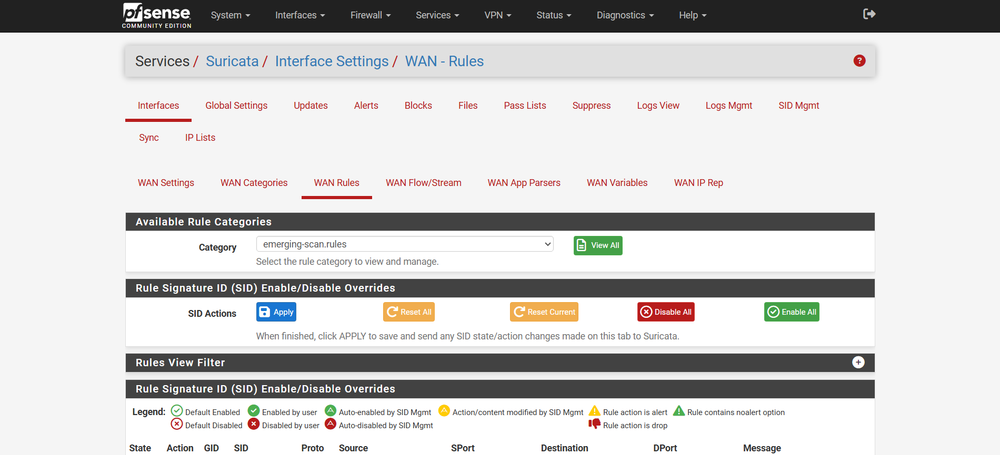
</p>

<p align="left">
  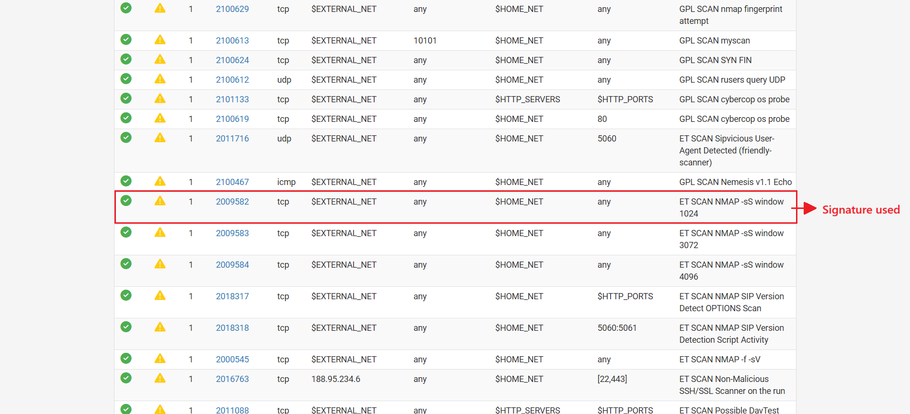
</p>

## Intrusion Detection Test (IDS)

A TCP SYN scan was performed from Kali Linux against the Ubuntu machine using Nmap to generate network reconnaissance traffic:

```bash
sudo nmap -sS -Pn -n -p 1-1000 192.168.1.100
```

The scan completed successfully, identifying the Ubuntu host and probing 1,000 TCP ports. This generated traffic patterns that could be inspected by Suricata on the pfSense WAN interface.

<p align="left">
  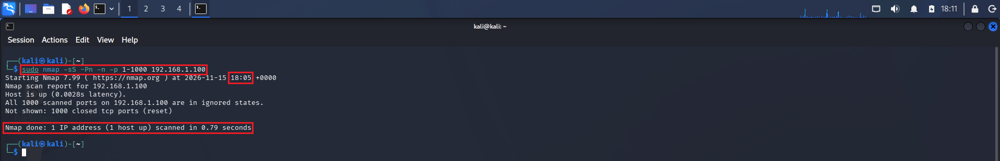
</p>

## IDS Alert Analysis

Suricata successfully detected the scanning activity and generated an alert matching the **ET SCAN NMAP -sS window 1024** signature (SID: `2009582`).

The alert log recorded the TCP traffic originating from Kali Linux (`192.168.15.5`) and targeting Ubuntu (`192.168.1.100`). The event was classified as **Attempted Information Leak**, with Priority 2, confirming that the traffic matched the configured detection signature.

<p align="left">
  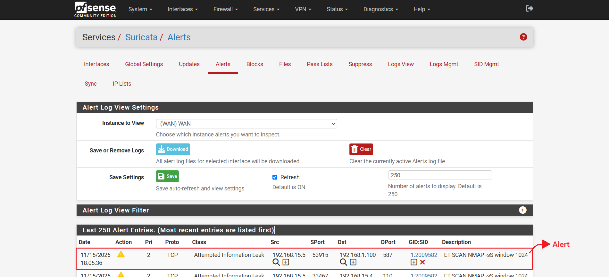
</p>

## Intrusion Prevention Test (IPS)

After completing the IDS tests, the **Block Offenders** option was enabled in the WAN interface configuration under **Services → Suricata → Interfaces → WAN**, with IPS Mode set to Legacy Mode. The same Nmap scan was then executed again from Kali Linux against Ubuntu to test automatic host blocking.

<p align="left">
  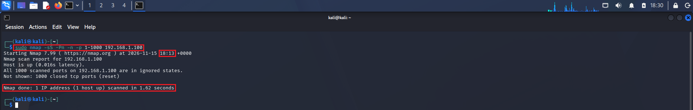
</p>

The Nmap output remained similar to the IDS test, with the scanned ports reported as closed (reset). In Legacy Mode, Suricata applies host-level blocking through the pfSense firewall after detecting matching activity, allowing some packets to pass before the block takes effect.

## IPS Alert Analysis

The pfSense Blocked Hosts page displayed the Kali Linux IP address (`192.168.15.5`) as an actively blocked host. The entry was associated with the detection signature **ET SCAN NMAP -sS window 1024** (SID: `2009582`), confirming that Suricata successfully triggered automatic host blocking.

<p align="left">
  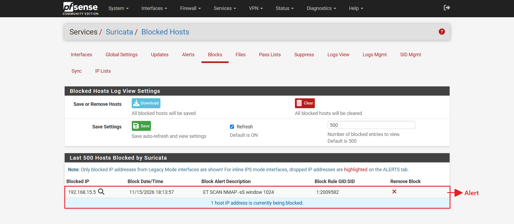
</p>

## Test Results

The tests demonstrated Suricata's intrusion detection and prevention capabilities. During the IDS test, the Nmap TCP SYN scan generated a security alert matching the configured ET Open signature. With Legacy Mode blocking enabled, Suricata subsequently identified the source IP address and added it to the pfSense blocking list.

This scenario demonstrated signature-based network intrusion detection, security alert analysis, and automated host blocking through Suricata integrated with pfSense.


